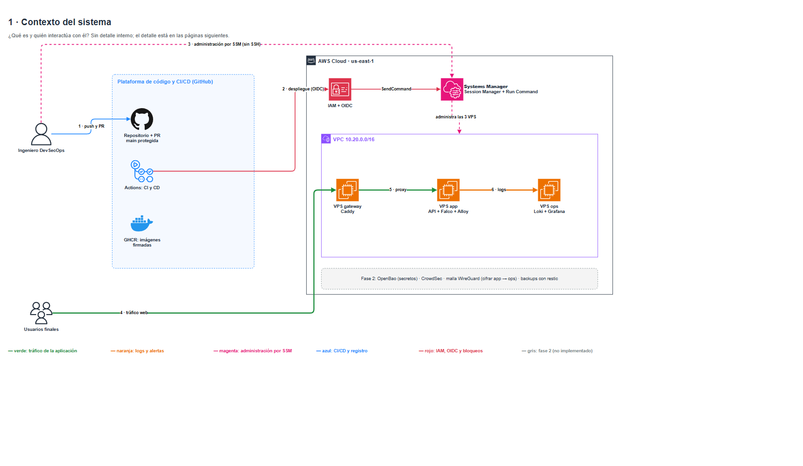

# devsecops-demo

Demo de buenas practicas DevSecOps sobre 3 VPS en AWS (EC2) con herramientas 100 % open source.

```
Internet --80--> [gateway: Caddy] --8000--> [app: API + Falco + Alloy] --3100--> [ops: Loki + Grafana]
                                                                           ^ acceso solo por tunel SSM
```

## Diagramas

Un solo archivo editable, [`docs/architecture.drawio`](docs/architecture.drawio), con 5 paginas (pestanas). Cada pagina responde una sola pregunta. Abrelo en diagrams.net o con la extension de draw.io; los iconos de marca se cargan desde internet.

| Pagina | Pregunta | Vista previa |
|---|---|---|
| 1. Contexto | Que es el sistema y quien interactua con el | [PNG](docs/architecture-1-contexto.png) |
| 2. Red y acceso | Quien puede hablar con quien | [PNG](docs/architecture-2-red-y-acceso.png) |
| 3. CI/CD y cadena de suministro | Como llega el codigo a produccion sin riesgo | [PNG](docs/architecture-3-cicd-y-cadena-de-suministro.png) |
| 4. Runtime y observabilidad | Como detectamos un incidente | [PNG](docs/architecture-4-runtime-y-observabilidad.png) |
| 5. Modelo de amenazas | Que puede salir mal y que lo frena | [PNG](docs/architecture-5-modelo-de-amenazas.png) |



## Controles

| Control | Donde |
|---|---|
| IaC con OpenTofu, SG de minimo privilegio, IMDSv2, EBS cifrado, **sin SSH** (acceso por SSM) | `infra/` |
| Hardening del host (CIS-style), auditd, sysctl, ufw, parches automaticos, Docker seguro | `ansible/roles/common`, `docker` |
| Contenedores: usuario no root, `read_only`, `cap_drop: ALL`, `no-new-privileges`, limites | `deploy/`, `app/Dockerfile` |
| Secretos, SAST, IaC, imagen y SBOM en cada PR (Gitleaks, Semgrep, Trivy, Checkov) | `.github/workflows/ci.yml` |
| Imagen firmada con Cosign (keyless) y firma verificada antes de desplegar | `ci.yml`, `deploy.yml` |
| Despliegue con OIDC (sin llaves de AWS en GitHub) | `infra/oidc.tf`, `deploy.yml` |
| Deteccion en runtime y logs centralizados (Falco, Alloy, Loki, Grafana) | `deploy/`, `ansible/roles/*` |

## Requisitos

- Cuenta de AWS con credenciales locales (`aws configure sso` o similar) y region `us-east-1`.
- **OpenTofu** >= 1.8, **AWS CLI v2** y el **plugin Session Manager** de AWS.
- **Ansible** (en Linux, macOS o WSL; Ansible no corre como nodo de control en Windows nativo) con `boto3`.
- Repositorio en GitHub con este codigo y Actions habilitado.

## Pasos

1. **Infraestructura**
   ```bash
   cd infra
   tofu init
   tofu plan -var 'github_repo=pieersx/devsecops-demo'
   tofu apply -var 'github_repo=pieersx/devsecops-demo'
   ```
   Guarda `github_deploy_role_arn` como variable de Actions `AWS_ROLE_ARN` y crea el entorno `demo` en GitHub.
2. **Configuracion**: edita `ansible/group_vars/all.yml` (la imagen ya apunta a `ghcr.io/pieersx`; el paquete de GHCR debe ser publico para la demo) y ejecuta:
   ```bash
   cd ansible
   export ANSIBLE_CONFIG=$PWD/ansible.cfg   # necesario en WSL sobre /mnt/c (directorio con permisos abiertos)
   ansible-galaxy collection install -r requirements.yml
   export ANSIBLE_SSM_BUCKET=$(cd ../infra && tofu output -raw ansible_ssm_bucket)
   ansible-playbook site.yml
   ```
3. **Pipeline**: haz push a `main`, copia la imagen firmada del resumen del job `publish` y lanza el workflow `deploy` con ese digest.

## Guion de la demo

1. Mostrar `tofu plan`: ningun puerto 22, solo el 80 del gateway.
2. Abrir sesion SSM en una VPS y ejecutar `sudo lynis audit system` (puntaje de hardening).
3. `bash demo/plant-vuln.sh`, push y PR: el pipeline **falla** (Trivy por la dependencia, Semgrep por `shell=True`).
4. Corregir, merge, imagen firmada, `deploy` verifica la firma y despliega.
5. Entrar a un contenedor con `docker exec -it ... sh`: Falco emite alerta, visible en el dashboard **DevSecOps · Runtime y alertas** de Grafana, carpeta DevSecOps (tunel: `aws ssm start-session --target <ops-id> --document-name AWS-StartPortForwardingSession --parameters portNumber=3000,localPortNumber=3000`).
6. Mostrar el SBOM descargado del job `build-scan`.

## Costos y limpieza

- 3 instancias (1 t3.micro + 2 t3.small), 3 IPv4 publicas y 60 GB de EBS: unos centavos por hora.
- **Al terminar: `cd infra && tofu destroy`.**

## Limitaciones conocidas

- Estado de OpenTofu local; en produccion usar backend remoto cifrado con bloqueo.
- HTTP sin dominio: con dominio propio Caddy gestiona TLS automaticamente.
- Alloy y Falco montan `docker.sock`/privilegios; es un riesgo conocido, mitigable con un proxy de socket.
- No incluye aun CrowdSec, Wazuh ni backups con restic (fase 2).
- Las acciones de GitHub estan fijadas por tag; en produccion fijarlas por SHA (Dependabot las mantiene).
