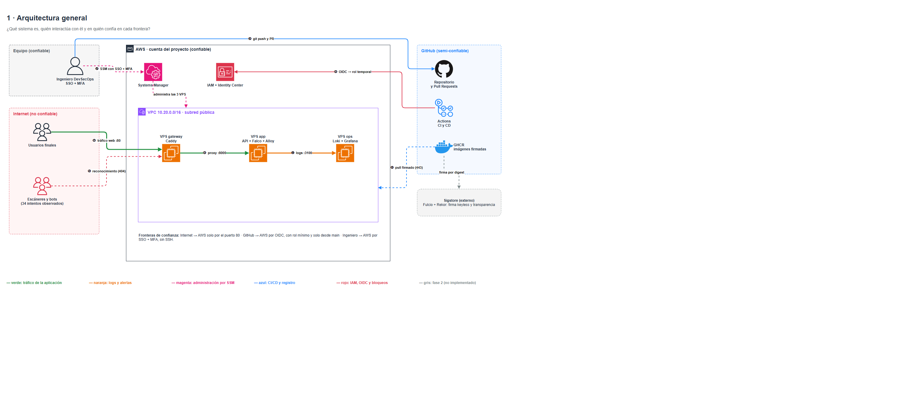
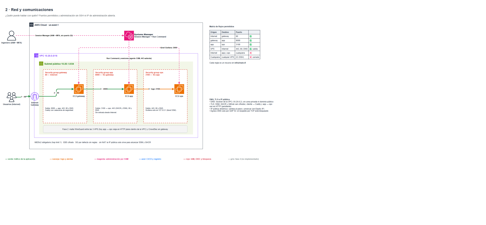
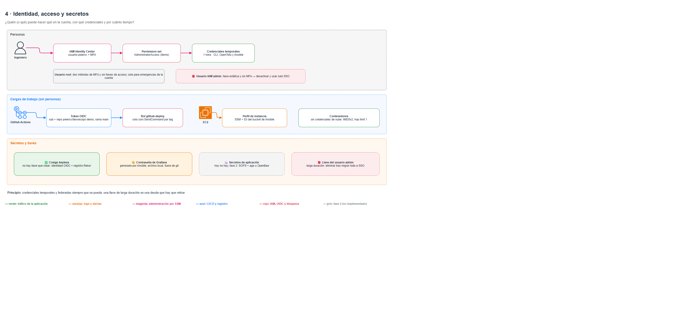
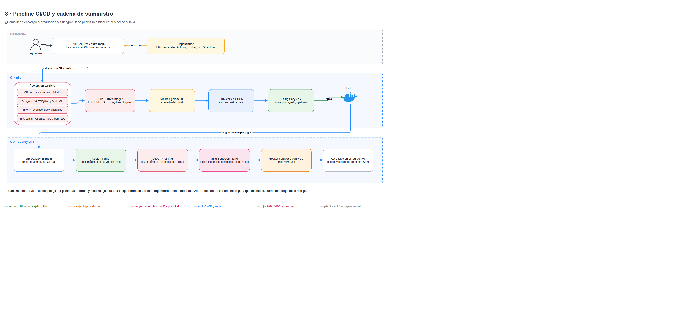

# Infraestructura y seguridad: documento de referencia

> **Estado del documento:** verificado contra la cuenta de AWS real el **2026-11-15** con comandos de solo lectura (ver el [apéndice A](#apéndice-a-cómo-verificar-este-documento)).
> **Naturaleza del entorno:** demo funcional para aprender y presentar prácticas DevSecOps. **No es producción.** Donde un control no existe, este documento lo dice.

| Dato | Valor |
|---|---|
| Proyecto | `devsecops-demo` (repositorio público `pieersx/devsecops-demo`) |
| Entorno | Un solo entorno (demo) en AWS, región `us-east-1`, zona `us-east-1a` |
| Propietario | `pieersx` |
| Audiencia | Ingeniería DevSecOps, revisores de seguridad y quien herede el entorno |
| Cómo se mantiene | Cada cambio de infraestructura actualiza este archivo y el diagrama en el mismo pull request |

## Índice

1. [Qué debe documentar un DevSecOps en 2026](#1-qué-debe-documentar-un-devsecops-en-2026)
2. [Resumen y principios de diseño](#2-resumen-y-principios-de-diseño)
3. [Inventario de activos](#3-inventario-de-activos)
4. [Arquitectura](#4-arquitectura)
5. [Red](#5-red)
6. [DNS](#6-dns)
7. [TLS y cifrado](#7-tls-y-cifrado)
8. [Catálogo de comunicaciones](#8-catálogo-de-comunicaciones)
9. [Identidad, acceso y secretos](#9-identidad-acceso-y-secretos)
10. [Cadena de suministro y CI/CD](#10-cadena-de-suministro-y-cicd)
11. [Hardening y línea base](#11-hardening-y-línea-base)
12. [Observabilidad, detección y respuesta](#12-observabilidad-detección-y-respuesta)
13. [Modelo de amenazas](#13-modelo-de-amenazas)
14. [Continuidad, cambio y costos](#14-continuidad-cambio-y-costos)
15. [Decisiones de arquitectura](#15-decisiones-de-arquitectura)
16. [Estándares de referencia](#16-estándares-de-referencia)
17. [Hoja de ruta de seguridad](#17-hoja-de-ruta-de-seguridad)
18. [Runbooks](#18-runbooks)
- [Apéndice A: cómo verificar este documento](#apéndice-a-cómo-verificar-este-documento)

---

## 1. Qué debe documentar un DevSecOps en 2026

La documentación de infraestructura sirve para tres cosas: **operar** sin su autor, **auditar** sin adivinar y **responder a incidentes** sin improvisar. Esta es la lista de lo que conviene tener, y dónde está aquí.

| Qué documentar | Por qué importa | Sección |
|---|---|---|
| Inventario de activos, versiones y propietario | No se protege lo que no se conoce | [3](#3-inventario-de-activos) |
| Arquitectura y fronteras de confianza | Quien llega nuevo entiende el sistema en 10 minutos | [4](#4-arquitectura) |
| Red: CIDR, rutas, reglas por puerto y salida | La mayoría de los incidentes en la nube son de configuración de red | [5](#5-red) |
| DNS: resolución, dominios, registros y propiedad | Un registro huérfano permite *subdomain takeover*; el DNS también es canal de fuga | [6](#6-dns) |
| TLS y cifrado en tránsito y en reposo, por tramo | Aclara qué viaja en claro y por qué | [7](#7-tls-y-cifrado) |
| Catálogo de flujos: origen, destino, puerto, cifrado, autenticación, registro | Es la base de las reglas de firewall y de la detección | [8](#8-catálogo-de-comunicaciones) |
| Identidad, permisos, caducidad de credenciales y cuenta de emergencia | Las credenciales robadas son la causa más frecuente de brechas | [9](#9-identidad-acceso-y-secretos) |
| Gestión de secretos y llaves | Dónde viven, quién los lee, cómo se rotan | [9.4](#94-secretos-y-llaves) |
| Cadena de suministro: qué se construye, cómo se firma, qué se verifica | Ataques a dependencias, imágenes y pipelines | [10](#10-cadena-de-suministro-y-cicd) |
| Línea base de hardening y cómo se comprueba | Un control sin verificación es una intención | [11](#11-hardening-y-línea-base) |
| Observabilidad, detección, retención y guía de respuesta | Detectar es inútil si nadie sabe qué hacer | [12](#12-observabilidad-detección-y-respuesta) |
| Modelo de amenazas con su estado | Prioriza el trabajo por riesgo y no por moda | [13](#13-modelo-de-amenazas) |
| Continuidad: respaldo, recuperación, RPO y RTO | Se descubre que falta cuando ya hace falta | [14](#14-continuidad-cambio-y-costos) |
| Gestión de cambio, despliegue y reversión | Reduce errores y acorta incidentes | [14](#14-continuidad-cambio-y-costos) |
| Costos y límites | Un entorno olvidado también es un riesgo | [14](#14-continuidad-cambio-y-costos) |
| Decisiones de arquitectura con alternativas | Evita reabrir la misma discusión | [15](#15-decisiones-de-arquitectura) |
| Estándares de referencia y estado de alineación | Habla el idioma de auditores y clientes | [16](#16-estándares-de-referencia) |
| Deuda técnica y hoja de ruta priorizada | Convierte las brechas en trabajo con dueño | [17](#17-hoja-de-ruta-de-seguridad) |
| Runbooks de las tareas críticas | Operar a las 3 a. m. sin pensar | [18](#18-runbooks) |
| Evidencia: cómo se comprobó cada afirmación | Un documento sin evidencia es una opinión | [Apéndice A](#apéndice-a-cómo-verificar-este-documento) |

**Reglas de estilo que sigue este documento**

1. **Describe el estado real, no el deseado.** Lo no implementado se marca como pendiente o fase 2.
2. **Cada afirmación es verificable** con un comando o un archivo del repositorio.
3. **Los diagramas son código** (`docs/architecture.drawio`) y se versionan con el resto.
4. **No contiene datos sensibles**: nada de ID de cuenta, correos, claves ni IP públicas, porque el repositorio es público.
5. **Lleva fecha de verificación** y se revisa en cada cambio de infraestructura.

Leyenda de estado: ✅ implementado y verificado · 🟡 parcial · 🔴 pendiente y relevante · ⬜ fase 2 (no implementado).

---

## 2. Resumen y principios de diseño

Tres VPS en AWS (`gateway`, `app` y `ops`) que sirven una API de ejemplo y demuestran un ciclo DevSecOps completo: infraestructura como código, acceso sin SSH, hardening, un pipeline con puertas de seguridad e imágenes firmadas, despliegue sin llaves y detección en tiempo de ejecución.

| Principio | Cómo se concreta |
|---|---|
| **Todo es código** | OpenTofu para la nube, Ansible para los hosts, Docker Compose para los servicios |
| **Sin SSH, sin llaves largas** | Acceso por Systems Manager con SSO; GitHub despliega por OIDC |
| **Mínimo privilegio** | Security groups por referencia, rol de despliegue acotado por etiqueta |
| **Defensa en profundidad** | Nube, sistema operativo, Docker y contenedor, cada capa con sus controles |
| **Confianza verificable** | Solo se ejecuta una imagen firmada por este mismo repositorio |
| **Detectar y poder explicarlo** | Falco, logs centralizados, dashboard y un método de triage |
| **Honestidad** | Las brechas conocidas están documentadas en la [hoja de ruta](#17-hoja-de-ruta-de-seguridad) |

---

## 3. Inventario de activos

### 3.1 Recursos en AWS

| Activo | Detalle verificado |
|---|---|
| Región y zona | `us-east-1`, todo en `us-east-1a` (sin alta disponibilidad) |
| VPC | `10.20.0.0/16`, DNS y nombres de host habilitados; SG por defecto sin reglas |
| Subred | `10.20.1.0/24`, única, pública; `MapPublicIpOnLaunch` desactivado (la IP pública se asigna por instancia) |
| Internet Gateway | 1; ruta `0.0.0.0/0` hacia él |
| EC2 `gateway` | `t3.micro`, Caddy |
| EC2 `app` | `t3.small`, API + Falco + Alloy |
| EC2 `ops` | `t3.small`, Loki + Grafana |
| AMI | Canonical `ubuntu-noble-24.04-amd64-server-20261108` (Ubuntu 24.04.5 LTS, kernel `7.0.0-1017-aws`) |
| Discos | 3 × 20 GB `gp3`, **cifrados** (fijado por instancia) |
| Metadatos (IMDS) | IMDSv2 obligatorio y *hop limit* 1 en las 3 instancias |
| Bucket S3 | `devsecops-demo-ssm-<id-de-cuenta>`: bloqueo de acceso público en las 4 opciones, cifrado AES256, expiración a 1 día; solo transporta módulos de Ansible |
| Roles de IAM | `devsecops-demo-vm` (perfil de instancia) y `devsecops-demo-github-deploy` (OIDC) |
| Proveedor OIDC | `token.actions.githubusercontent.com` |
| IAM Identity Center | Instancia de organización de una sola región (`us-east-1`), clave de cifrado propiedad de AWS |
| Organización de AWS | Creada al habilitar Identity Center; la cuenta es la cuenta de administración |

### 3.2 Software en ejecución

| Componente | Versión | Dónde |
|---|---|---|
| Docker / Compose | 29.1.3 / 2.40.3 | las 3 VPS |
| Caddy | 2.9 | `gateway` |
| API de ejemplo | FastAPI 0.163.0, Starlette 1.10.0, Uvicorn 0.54.0 sobre `python:3.12-slim` | `app` |
| Falco | 0.45.2 (sensor eBPF) | `app` |
| Grafana Alloy | v1.21.3 | `app` |
| Loki | 3.3.2 | `ops` |
| Grafana | 11.4.0 | `ops` |
| Agente SSM | 3.3.4793.0 | las 3 VPS |

### 3.3 Servicios y herramientas externos

| Servicio | Uso |
|---|---|
| GitHub (repositorio público) | Código, pull requests, Actions y Dependabot |
| GitHub Container Registry (GHCR) | Imágenes; paquete público |
| Sigstore (Fulcio y Rekor) | Firma *keyless* y registro de transparencia |
| OpenTofu ≥ 1.8, proveedor `aws` ≥ 5.81 y < 7 | Infraestructura como código; el estado es un archivo **local** |
| Ansible (core 2.20) | Configuración de hosts por `aws_ssm` |

### 3.4 Datos

No hay bases de datos, datos de usuarios ni información personal. Los únicos datos son **logs operativos** (Loki, en un volumen Docker sobre el disco cifrado de `ops`). Clasificación: **sin datos sensibles**. Esta clasificación debe revisarse antes de conectar cualquier dato real.

---

## 4. Arquitectura



### 4.1 Responsabilidad de cada VPS

| VPS | Función | Componentes | Exposición |
|---|---|---|---|
| `gateway` | Único punto de entrada | Caddy (proxy inverso, cabeceras de seguridad) | Puerto 80 desde Internet |
| `app` | Aplicación y detección | API FastAPI, Falco, Alloy | 8000 solo desde el SG del gateway |
| `ops` | Observabilidad | Loki, Grafana | 3100 solo desde el SG de `app`; Grafana solo en `127.0.0.1` |

### 4.2 Fronteras de confianza

| Frontera | Quién cruza | Control |
|---|---|---|
| Internet → AWS | Usuarios y escáneres | Solo el puerto 80 del `gateway` |
| GitHub → AWS | Pipeline de despliegue | OIDC, rol mínimo, solo desde `main`, imagen verificada con Cosign |
| Ingeniero → AWS | Administración | SSO con credenciales temporales, sin SSH |
| `gateway` → `app` → `ops` | Tráfico interno | Security groups por referencia y salida restringida |

---

## 5. Red



### 5.1 Direccionamiento

| Elemento | Valor |
|---|---|
| VPC | `10.20.0.0/16` |
| Subred pública | `10.20.1.0/24` (zona `us-east-1a`) |
| Direcciones privadas | Las asigna AWS dentro de la subred; son estables mientras la instancia exista |
| IPv6 | No se usa |
| NACL | La predeterminada de la VPC (permite todo); el control real son los security groups |

### 5.2 Security groups (estado verificado)

| SG | Entrada | Salida |
|---|---|---|
| `gateway` | TCP 80 desde `0.0.0.0/0` | TCP 8000 → SG `app`; TCP 443 y 80 → Internet; UDP 53 → VPC |
| `app` | TCP 8000 desde SG `gateway` | TCP 3100 → SG `ops`; TCP 443 y 80 → Internet; UDP 53 → VPC |
| `ops` | TCP 3100 desde SG `app` | TCP 443 y 80 → Internet; UDP 53 → VPC |
| `default` | Ninguna | Ninguna |

Matriz resumida de lo permitido:

| Origen | Destino | Puerto | Estado |
|---|---|---|---|
| Internet | `gateway` | 80 | ✅ permitido |
| `gateway` | `app` | 8000 | ✅ permitido |
| `app` | `ops` | 3100 | ✅ permitido |
| Cualquier VPS | Internet | 443, 80 y DNS | ✅ salida (necesaria para SSM, GHCR y paquetes) |
| Internet | `app` y `ops` | cualquiera | ❌ bloqueado |
| Cualquiera | cualquier VPS | 22 (SSH) | ❌ cerrado; el servicio SSH está desactivado |

### 5.3 Decisiones y límites conocidos

| Tema | Estado |
|---|---|
| **Sin NAT ni subred privada** | 🟡 Las VPS tienen IP pública para llegar a SSM, GHCR y los repositorios de paquetes. No hay entrada hacia ellas salvo el puerto 80 del gateway. En producción: subredes privadas con *VPC endpoints* de `ssm`, `ssmmessages`, `ec2messages` y S3, y NAT solo si hace falta |
| **IP pública dinámica** | 🟡 Cambia al parar y arrancar la instancia (ocurrió al redimensionar `app`). No hay Elastic IP; es imprescindible antes de apuntar un DNS al gateway |
| **Salida abierta a Internet por 443 y 80** | 🟡 Necesaria hoy; se podría acotar con endpoints y listas de destinos permitidos |
| **Sin VPC Flow Logs** | 🔴 No hay trazabilidad de red; ver [hoja de ruta](#17-hoja-de-ruta-de-seguridad) |
| **Firewall del host (`ufw`)** | 🟡 Activo con entrada denegada por defecto y el puerto del rol permitido. **Docker publica puertos saltándose `ufw`**, por lo que el control principal es el security group |
| **Una sola zona** | ⬜ Sin alta disponibilidad: si cae `us-east-1a`, cae el servicio |

---

## 6. DNS

| Ámbito | Estado | Detalle |
|---|---|---|
| Resolución dentro de la VPC | ✅ | Resolver de la VPC en `10.20.0.2`; dominio `ec2.internal`; `enableDnsSupport` y `enableDnsHostnames` activos |
| Zona privada de Route 53 | ⬜ | No existe |
| Dominio público y zona de Route 53 | ⬜ | No existe |
| Certificados en ACM | ⬜ | No existen |
| Nombres internos entre servicios | 🟡 | Los servicios se hablan por **IP privada** (Caddy → API, Alloy → Loki). Si una IP cambia, hay que reconfigurar |
| Salida DNS | 🟡 | Los security groups permiten **solo UDP 53** hacia la VPC; el respaldo por TCP 53 (respuestas grandes) queda bloqueado |
| Sincronización de hora | ✅ | `chrony` con Amazon Time Sync (`169.254.169.123`); reloj sincronizado, zona UTC |

**Buenas prácticas de DNS que conviene tener documentadas y aplicar antes de producción**

1. **Dominio propio y zona en Route 53**, con registros `A` al Elastic IP del gateway; con dominio, Caddy obtiene y renueva TLS automáticamente.
2. **Zona privada** (por ejemplo `internal.<dominio>`) con nombres estables para `app` y `ops`, en lugar de IP.
3. **Registros CAA** para limitar qué autoridades pueden emitir certificados del dominio.
4. **DNSSEC** en la zona pública cuando el registrador lo permita.
5. **Inventario de registros** y revisión periódica para evitar registros huérfanos (*subdomain takeover*).
6. **Registro de consultas del resolver** (Route 53 Resolver query logging) y, si procede, **DNS Firewall**: el DNS es un canal habitual de exfiltración y de comando y control.
7. **TTL bajos** antes de un cambio planificado y subirlos después.
8. Permitir **TCP 53** además de UDP 53 en la salida hacia el resolver.

---

## 7. TLS y cifrado

### 7.1 En tránsito, tramo por tramo

| Tramo | Cifrado | Estado |
|---|---|---|
| Cliente → Caddy (puerto 80) | **HTTP en claro**: no hay dominio, por tanto no hay TLS | 🔴 |
| Caddy → API (8000) | HTTP dentro de la VPC | 🟡 |
| Alloy → Loki (3100) | HTTP dentro de la VPC | 🟡 |
| Ingeniero → Grafana | Túnel de Session Manager (TLS) hacia `127.0.0.1:3000` | ✅ |
| Agente SSM ↔ Systems Manager | TLS, conexión saliente por 443 | ✅ |
| VPS → GHCR, GitHub y AWS | HTTPS | ✅ |
| VPS → repositorios apt de Ubuntu | HTTP 80; la integridad la garantiza la firma de los paquetes | 🟡 |
| Ansible → S3 | HTTPS | ✅ |

### 7.2 En reposo

| Dato | Cifrado | Estado |
|---|---|---|
| Discos de las VPS | EBS con clave administrada por AWS, fijado por instancia | ✅ |
| Cifrado de EBS **por defecto** de la región | Desactivado | 🔴 un volumen nuevo podría crearse sin cifrar |
| Bucket S3 | SSE-S3 (AES256) | ✅ |
| Logs en Loki | En el disco cifrado de `ops` | ✅ |
| Identity Center | Clave propiedad de AWS | ✅ |

### 7.3 Pendiente

HTTPS con dominio y HSTS en el gateway; TLS o malla WireGuard entre VPS (ver ADR-9); claves gestionadas por el cliente (KMS) si algún requisito normativo lo exige; activar el cifrado de EBS por defecto en la región.

---

## 8. Catálogo de comunicaciones

| # | Origen → destino | Puerto / protocolo | Cifrado | Autenticación | Propósito | Registro |
|---|---|---|---|---|---|---|
| F1 | Cliente → `gateway` | TCP 80 / HTTP | No | Ninguna (público) | Tráfico web | Logs de Caddy en el host (**no** llegan a Loki) |
| F2 | `gateway` → `app` | TCP 8000 / HTTP | No | SG por referencia | Proxy hacia la API | Logs de la API en Loki |
| F3 | `app` (Alloy) → `ops` (Loki) | TCP 3100 / HTTP | No | SG por referencia | Envío de logs | Métricas del propio Loki |
| F4 | Ingeniero → Grafana | Túnel SSM al puerto 3000 | TLS | SSO (IAM) | Consulta de dashboards | Evento de SSM en CloudTrail (historial) |
| F5 | Ingeniero → VPS | Session Manager / Run Command | TLS | SSO (IAM) | Administración | Evento de SSM en CloudTrail (historial) |
| F6 | Ansible → VPS | `aws_ssm` + S3 | TLS | SSO (IAM) | Configuración | Salida de Ansible |
| F7 | VPS → GHCR | HTTPS 443 | TLS | Ninguna (paquete público) | Descarga de la imagen | Docker |
| F8 | VPS → Ubuntu y AWS | HTTP 80 y HTTPS 443 | Mixto | Firma de paquetes | Parches y agente | `apt` |
| F9 | GitHub Actions → AWS | HTTPS | TLS | Token OIDC → rol temporal | Orden de despliegue por SSM | Salida del job |
| F10 | GitHub Actions → GHCR y Sigstore | HTTPS | TLS | `GITHUB_TOKEN` y OIDC | Publicar y firmar la imagen | Rekor (registro público) |
| F11 | Falco → Alloy | `stdout` del contenedor (`json-file`) | Local | No aplica | Alertas | Loki |
| F12 | Alloy → Docker | Socket `docker.sock` de solo lectura | Local | Permiso del archivo | Descubrir y leer logs | No aplica |

---

## 9. Identidad, acceso y secretos



### 9.1 Personas

| Identidad | Mecanismo | Estado |
|---|---|---|
| Ingeniero (`pieersx`) | IAM Identity Center; permission set `AdministratorAccess`; credenciales de **1 hora** | ✅ temporal · 🟡 permisos totales |
| Usuario **root** | MFA habilitado (dos métodos), **sin llaves de acceso**; solo para emergencias de la cuenta | ✅ |
| Usuario IAM `admin` (anterior) | `AdministratorAccess`, **una llave de acceso activa** (creada el 2026-08-25) y **sin MFA** | 🔴 |
| MFA del usuario de Identity Center | No se ha verificado que tenga un dispositivo registrado | 🟡 comprobar |

### 9.2 Cargas de trabajo

| Identidad | Mecanismo | Permisos |
|---|---|---|
| GitHub Actions (despliegue) | Token OIDC → rol `devsecops-demo-github-deploy`; solo confía en la rama `main` de este repositorio | `ssm:SendCommand` sobre instancias con la etiqueta del proyecto y el documento `AWS-RunShellScript`; lectura de resultados |
| Instancias EC2 | Perfil de instancia `devsecops-demo-vm` | `AmazonSSMManagedInstanceCore` y lectura/escritura en el bucket de Ansible |
| Contenedores | Sin credenciales de nube | IMDSv2 obligatorio con *hop limit* 1: un contenedor no alcanza el IMDS |

### 9.3 Políticas

1. **Credenciales temporales** siempre que sea posible; una llave de larga duración es deuda a retirar.
2. **MFA obligatorio** en cualquier identidad humana, incluida la cuenta de emergencia.
3. **Root solo para emergencias**: nunca para el trabajo diario.
4. **Mínimo privilegio**: el permiso `AdministratorAccess` es aceptable en una demo personal y no en un equipo.
5. **Revisión trimestral** de usuarios, roles y llaves (`aws iam generate-credential-report`).

### 9.4 Secretos y llaves

| Secreto | Dónde vive | Rotación | Estado |
|---|---|---|---|
| Firma de imágenes (Cosign) | **No hay llave**: firma *keyless* con la identidad OIDC de GitHub y registro en Rekor | No aplica | ✅ |
| Contraseña de administración de Grafana | La genera Ansible en un archivo local del controlador (`ansible/credentials/`, fuera de git); se copia a la VPS `ops` | Manual; **solo se lee en el primer arranque**, por lo que rotarla exige `grafana cli admin reset-admin-password` | 🟡 |
| Secretos de aplicación | No existen | No aplica | ⬜ fase 2: SOPS + age; OpenBao si crecen los equipos |
| Llave de acceso del usuario `admin` | Perfil local de AWS CLI | Ninguna | 🔴 desactivar y eliminar |

---

## 10. Cadena de suministro y CI/CD



### 10.1 Puertas de seguridad

Corren en paralelo en cada pull request y en cada push a `main`; si una falla, el build no se ejecuta.

| Puerta | Herramienta | Qué detecta | Job de `ci.yml` |
|---|---|---|---|
| Secretos | Gitleaks | Credenciales en el historial | `secrets` |
| SAST | Semgrep (reglas de Python y Dockerfile) | Código inseguro, por ejemplo `shell=True` | `sast` |
| Dependencias | Trivy `fs` | Vulnerabilidades HIGH y CRITICAL en `requirements.txt` | `deps` |
| IaC | Trivy `config` y Checkov | Errores de configuración de OpenTofu, Dockerfile y workflows | `iac` |

### 10.2 Construcción, firma y despliegue

| Paso | Detalle |
|---|---|
| Build y escaneo | Se construye la imagen y Trivy bloquea HIGH y CRITICAL con corrección disponible |
| SBOM | Se genera en formato CycloneDX y se guarda como artefacto del job |
| Publicación | Solo en `push` a `main`: se sube a GHCR con el SHA del commit y con `latest` |
| Firma | Cosign *keyless* sobre el **digest** de la imagen |
| Despliegue | `deploy.yml` (manual): verifica la firma con la identidad `ci.yml@refs/heads/main`, asume el rol por OIDC y ejecuta `docker compose pull && up` en `app` por SSM |
| Actualizaciones | Dependabot semanal para GitHub Actions, Docker, Docker Compose, pip y OpenTofu |

### 10.3 Evidencia de funcionamiento

Un pull request con una dependencia vulnerable (`pyyaml 5.3.1`, CVE-2020-14343, CRITICAL) y código con `shell=True` **hizo fallar a Semgrep y a Trivy**, y se saltaron el build y la publicación.

### 10.4 Brechas

| Brecha | Estado |
|---|---|
| `main` **no tiene protección de rama**: un PR con checks fallidos puede fusionarse | 🔴 |
| El entorno `demo` del despliegue puede no tener revisores obligatorios configurados (comprobarlo en la configuración de GitHub) | 🟡 |
| Las acciones de GitHub se fijan por **etiqueta**, no por SHA | 🟡 |
| No se publican atestaciones de procedencia (por ejemplo `actions/attest-build-provenance`) | ⬜ |
| El contenedor de la API corre con la etiqueta `latest`; solo `deploy.yml` fija el digest | 🟡 |

---

## 11. Hardening y línea base

Los controles del sistema operativo y de Docker se **verificaron en la VPS `app`**; el rol de Ansible `common` se aplica igual a las tres. Los de nube se verificaron en las tres.

| Capa | Control | Verificación | Resultado |
|---|---|---|---|
| Nube | IMDSv2 obligatorio con *hop limit* 1 | `describe-instances` | ✅ las 3 VPS |
| Nube | Discos cifrados | `describe-volumes` | ✅ |
| Nube | Security groups por referencia y salida restringida | `describe-security-groups` | ✅ |
| SO | SSH desactivado (`ssh` y `ssh.socket`) | `systemctl is-active` | ✅ inactivos |
| SO | Parches automáticos (`unattended-upgrades`) | `systemctl is-active` | ✅ activo |
| SO | `auditd` con reglas sobre identidad, `sudo` y Docker | `auditctl -l` | ✅ 6 reglas |
| SO | Firewall `ufw` con entrada denegada por defecto | `ufw status` | ✅ activo |
| SO | `sysctl` endurecido (SYN cookies, ASLR, `kptr_restrict`, redirecciones desactivadas) | `sysctl -n` | ✅ |
| SO | Hora sincronizada | `timedatectl` y `chronyc sources` | ✅ |
| Docker | `no-new-privileges`, `live-restore`, `userland-proxy` desactivado, rotación de logs | `/etc/docker/daemon.json` | ✅ |
| Contenedor API | Usuario sin root (uid 10001), raíz de solo lectura, `cap_drop: ALL`, 256 MB, 100 procesos, healthcheck | `deploy/compose.app.yml` | ✅ |
| Contenedor Falco | Privilegiado a propósito (carga la sonda eBPF); aislado en `app` | `deploy/compose.app.yml` | 🟡 riesgo asumido |
| Contenedor Alloy | `root` sin capacidades, estado en `tmpfs`, lee `docker.sock` en solo lectura | `deploy/compose.app.yml` | 🟡 riesgo asumido |

**Auditoría con Lynis** (VPS `app`): **índice de hardening 69 de 100**, 256 pruebas, 0 advertencias. Sugerencias pendientes menores: `libpam-tmpdir`, `apt-listbugs`, `apt-listchanges`, desactivar volcados de memoria y contraseña de GRUB (esta última no aplica en una nube).

**Línea base de referencia**

| Referencia | Aplicación | Estado |
|---|---|---|
| CIS Ubuntu Linux 24.04 | Parcial, por Ansible; sin auditoría con la herramienta oficial | 🟡 |
| CIS Docker | Parcial (daemon y contenedores) | 🟡 |
| CIS AWS Foundations | No evaluado: no hay Security Hub ni Prowler | ⬜ |

---

## 12. Observabilidad, detección y respuesta

### 12.1 Señales y destinos

| Fuente | Qué aporta | Destino | Estado |
|---|---|---|---|
| Falco (eBPF) | Alertas con técnica MITRE, proceso, padre, contenedor | Loki | ✅ |
| API FastAPI | Peticiones HTTP y errores | Loki | ✅ |
| `auditd` | Cambios en identidad, `sudo` y Docker | Solo en el host | 🟡 no se envía a Loki |
| Caddy | Logs de acceso en JSON | Solo en el host | 🔴 no llegan a Loki |
| CloudTrail | Eventos de administración de AWS | **Solo historial de 90 días**: no hay trail propio | 🔴 |
| VPC Flow Logs, GuardDuty, AWS Config | Red y comportamiento de la cuenta | No habilitados | ⬜ |

Cada línea de log lleva las etiquetas `host` y `container`, y Loki completa `service_name`.

### 12.2 Dashboard «DevSecOps · Runtime y alertas»

Se carga por archivo (no editable desde la interfaz) desde `ansible/roles/ops/files/dashboards/`. Paneles: alertas de Falco, **alertas dentro de contenedores** (debe ser 0), errores 4xx y 5xx de la API, peticiones reales (sin el healthcheck), alertas por regla, quién las dispara (proceso y proceso padre), listas separadas de alertas de contenedor y de host, y volumen de logs por contenedor.

### 12.3 Triage en cuatro preguntas

| Pregunta | Dónde se lee | Ejemplo |
|---|---|---|
| ¿Quién? | `user_name`, `proc_name` | `root`, `cat` |
| ¿Qué lo lanzó? | `proc_pname` (proceso padre) | `containerd-shim` = `docker exec`; `lynis` = auditoría |
| ¿Cuándo? | Hora del evento | ¿Coincide con una tarea nuestra? |
| ¿Dónde? | `container_name` | Un contenedor concreto o `host` |

El **filtrado de falsos positivos se hace en la vista, no en el detector**: no se crea una excepción global en Falco para herramientas como Lynis, porque un nombre de proceso se puede imitar.

### 12.4 Observado en el entorno real

| Hallazgo | Detalle |
|---|---|
| Alertas reales de Falco | 8 en tres horas: 5 de `Read sensitive file untrusted` y 3 de `Clear Log Activities`, casi todas de Lynis; 1 dentro de un contenedor (prueba controlada) |
| Escáneres de Internet | 34 peticiones con 404 a rutas como `*.php` y `wp-content/...`, buscando *webshells*. La API no tiene esas rutas |
| IP de origen | La API solo ve la IP privada del gateway: **se pierde la IP real del cliente** |

### 12.5 Guía de respuesta

| Situación | Acción |
|---|---|
| Alerta de Falco **dentro de un contenedor** | 1) Abrir una sesión SSM en `app`. 2) `docker ps` y `docker inspect` del contenedor. 3) Revisar proceso, padre y comando. 4) Si no es una prueba, aislar: quitar la regla de entrada del SG o detener el contenedor. 5) Conservar logs y la imagen. 6) Recrear la VPS desde código |
| Ráfaga de 404 a rutas `.php` | Normal en Internet. Comprobar que no haya respuestas 200 a rutas inesperadas. Si crece, activar CrowdSec o WAF |
| `Clear Log Activities` con un padre desconocido | Tratar como grave: es una técnica de ocultación de rastros |
| Inicio de sesión inesperado en AWS | Revocar sesiones, revisar CloudTrail, rotar credenciales y comprobar el usuario `admin` |

---

## 13. Modelo de amenazas

| ID | Amenaza | Control | Estado |
|---|---|---|---|
| T1 | Explotación de la API (inyección, ejecución remota) | Semgrep en cada PR; contenedor sin root, solo lectura, `cap_drop: ALL`; Falco en runtime | 🟡 |
| T2 | Secreto filtrado en git | Gitleaks; sin llaves de AWS en GitHub (OIDC); SOPS u OpenBao para secretos de aplicación | 🟡 |
| T3 | Dependencia o imagen vulnerable o manipulada | Trivy (dependencias e imagen); SBOM; Cosign y verificación antes de desplegar; Dependabot | 🟡 |
| T4 | Robo de credenciales de la nube | SSO de 1 hora y OIDC; pendiente retirar la llave estática del usuario `admin` | 🟡 |
| T5 | Movimiento lateral entre VPS | SG por referencia, salida restringida, IMDSv2 con *hop limit* 1; fase 2: TLS o WireGuard | 🟡 |
| T6 | Acceso administrativo no autorizado | Sin SSH; Session Manager con SSO y MFA; `auditd`; pendiente MFA en el usuario `admin` | 🟡 |
| T7 | Intercepción de logs en tránsito | Brecha conocida: HTTP dentro de la VPC | ⬜ |
| T8 | Cambio de infraestructura sin revisión | IaC en PR; Trivy `config` y Checkov; `tofu apply` manual | 🟡 |
| T9 | Reconocimiento y escaneo de la IP pública | SG solo con el 80; API sin rutas inútiles; panel de errores 4xx y 5xx; fase 2: CrowdSec o WAF y HTTPS | 🟡 |
| T10 | Fusionar un PR con checks fallidos | **Sin protección de rama**: el CI detecta, pero no impide el merge | 🔴 |

Los controles de CI **detectan**; sin protección de rama no **impiden** el merge. Por eso T1, T3 y T8 figuran como parciales.

---

## 14. Continuidad, cambio y costos

### 14.1 Continuidad

| Aspecto | Estado |
|---|---|
| Respaldo | 🔴 No hay respaldos. Los únicos datos son logs operativos, que se pueden perder en esta demo |
| Recuperación | La infraestructura es reproducible: `tofu apply` + Ansible. **RTO observado ≈ 15 minutos** (≈ 1 min de apply, ≈ 3 min hasta que SSM ve las VPS y ≈ 8 min de Ansible) |
| RPO | Sin objetivo definido; para logs, aceptable en una demo |
| Alta disponibilidad | ⬜ Una sola zona y una VPS por rol |

### 14.2 Cambio y despliegue

1. Cambio en una rama → pull request → el CI ejecuta las 4 puertas, el build, el escaneo y el SBOM.
2. Fusión a `main` → se publica y firma la imagen.
3. Despliegue manual con `deploy.yml`, indicando el **digest** de la imagen.
4. **Reversión**: volver a lanzar `deploy.yml` con el digest de la versión anterior.
5. Los cambios de infraestructura pasan por `tofu plan` revisado antes de `tofu apply`.

### 14.3 Costos

| Concepto | Estimación |
|---|---|
| 1 × `t3.micro` + 2 × `t3.small` | ≈ 0,05 USD/h |
| 3 direcciones IPv4 públicas | ≈ 0,015 USD/h |
| 60 GB de EBS `gp3` | ≈ 0,007 USD/h |
| **Total aproximado** | **≈ 0,07 USD/h (≈ 1,8 USD/día)** |

Son estimaciones; conviene contrastarlas con la calculadora de precios de AWS. **No hay presupuesto ni alerta de costos configurados** (🔴). Al terminar una demo, `tofu destroy`.

---

## 15. Decisiones de arquitectura

| ID | Decisión | Alternativas | Consecuencias |
|---|---|---|---|
| ADR-1 | **Systems Manager en lugar de SSH o VPN** | SSH con llaves, WireGuard | Sin puerto 22 ni llaves; sesiones auditadas por IAM. Solo funciona en AWS: en otros proveedores haría falta WireGuard |
| ADR-2 | **OpenTofu** en lugar de Terraform | Terraform (licencia BUSL) | Licencia abierta; mismo lenguaje |
| ADR-3 | **Docker Compose** en lugar de Kubernetes | K3s, ECS | Menos piezas para 3 VPS; sin orquestación ni autorreparación |
| ADR-4 | **Falco (eBPF)** para detección en runtime | Wazuh, auditd solo | Detecta a nivel de kernel con contexto de contenedor; exige privilegios y un kernel compatible |
| ADR-5 | **Loki + Grafana** para logs | Wazuh, ELK | Ligero y barato; sin correlación avanzada |
| ADR-6 | **Identity Center** en lugar de usuarios IAM | Usuarios IAM con llaves | Credenciales temporales y MFA; crea una organización de AWS |
| ADR-7 | **Cosign keyless** | Llave propia o KMS | Sin llave que custodiar; depende de Sigstore |
| ADR-8 | **HTTP sin dominio** en la demo | HTTPS con dominio | Más simple; el tráfico va en claro (pendiente) |
| ADR-9 | **Tráfico interno sin TLS** | TLS en Loki, WireGuard | Aceptable en una VPC de demo; pendiente en producción |
| ADR-10 | **Filtrar en la vista, no en el detector** | Excepciones en Falco | Falco registra todo y no abre un punto ciego |
| ADR-11 | **`app` en `t3.small`** | `t3.micro` | Con 1 GB, Falco moría por falta de memoria (`OOMKilled`) |
| ADR-12 | **SOPS y OpenBao diferidos** | OpenBao desde el inicio | Menos piezas críticas; los secretos de aplicación aún no existen |
| ADR-13 | **IP pública sin NAT** | Subred privada + endpoints | Menor costo; superficie de IP pública (ver 5.3) |

---

## 16. Estándares de referencia

Se usan como **guía**; este entorno no ha pasado ninguna auditoría formal y no afirma cumplimiento.

| Referencia | Para qué se usa aquí |
|---|---|
| CIS Benchmarks (AWS Foundations, Ubuntu 24.04, Docker) | Línea base de configuración |
| NIST CSF 2.0 | Marco de funciones: gobernar, identificar, proteger, detectar, responder y recuperar |
| NIST SSDF (SP 800-218) | Prácticas de desarrollo seguro y de cadena de suministro |
| SLSA | Niveles de integridad de la cadena de construcción |
| OWASP Top 10 y OWASP CI/CD Top 10 | Riesgos de la aplicación y del pipeline |
| MITRE ATT&CK | Lenguaje común: las alertas de Falco llevan etiquetas de técnica |
| OpenSSF Scorecard | Evaluación automática de la salud del repositorio |
| ISO/IEC 27001 (Anexo A) | Referencia de controles para auditorías |

---

## 17. Hoja de ruta de seguridad

| Prioridad | Brecha | Riesgo | Siguiente paso | Esfuerzo |
|---|---|---|---|---|
| 🔴 Alta | `main` sin protección de rama | Un PR con checks fallidos se puede fusionar | Exigir PR y los checks del CI; bloquear *force-push* | Bajo |
| 🔴 Alta | Usuario IAM `admin` con llave estática y sin MFA | Credencial de larga duración con permisos totales | Desactivar la llave, activar MFA o eliminar el usuario; usar solo SSO | Bajo |
| 🔴 Alta | Sin CloudTrail propio | Solo 90 días de historial; sin evidencia duradera | Crear un trail multirregión con validación de integridad hacia S3 | Bajo |
| 🟡 Media | IP real del cliente y logs de Caddy ausentes | No se puede rastrear ni bloquear al atacante | Alloy en el gateway y `--proxy-headers` en Uvicorn | Medio |
| 🟡 Media | Escaneos de Internet en el puerto 80 | Reconocimiento previo a un ataque dirigido | CrowdSec o WAF, y HTTPS con dominio | Medio |
| 🟡 Media | Logs entre `app` y `ops` en HTTP | Intercepción dentro de la VPC | TLS en Loki o malla WireGuard | Medio |
| 🟡 Media | Humano con `AdministratorAccess` | Un error o una cuenta robada afecta a toda la cuenta | Permission set acotado a lo que OpenTofu necesita | Medio |
| 🟡 Media | Cifrado de EBS e IMDSv2 no son predeterminados en la cuenta | Un recurso nuevo podría crearse sin esos controles | `enable-ebs-encryption-by-default` y `modify-instance-metadata-defaults` | Bajo |
| 🟡 Media | Acciones de GitHub fijadas por etiqueta; entorno `demo` sin revisores verificados | Cadena de suministro y aprobación débiles | Fijar por SHA y exigir revisores en el entorno | Bajo |
| 🟡 Media | Secretos de aplicación sin gestor | Contraseñas en archivos locales | SOPS + age; OpenBao si crecen los equipos | Medio |
| 🟡 Media | Estado de OpenTofu en un archivo local | Pérdida o filtración del estado | Backend remoto en S3 cifrado y con bloqueo | Bajo |
| 🟡 Media | Sin evaluación CIS de la cuenta | Errores de configuración sin detectar | Ejecutar Prowler o Security Hub; habilitar GuardDuty | Bajo |
| ⬜ Baja | Alertas solo visuales | Un incidente puede pasar desapercibido | Grafana Alerting hacia Slack o correo | Medio |
| ⬜ Baja | Sin VPC Flow Logs, subred privada ni respaldos | Poca trazabilidad de red y sin recuperación | Flow Logs, subredes privadas con endpoints y `restic` a S3 | Alto |
| ⬜ Baja | Sin presupuesto ni alerta de costos | Gasto inesperado si se olvida un `destroy` | AWS Budgets con aviso por correo | Bajo |

---

## 18. Runbooks

Todos los comandos asumen WSL o Linux con el perfil SSO `demo` activo (`export AWS_PROFILE=demo`).

### 18.1 Desplegar desde cero

```bash
cd infra && tofu init
tofu plan  -var 'github_repo=pieersx/devsecops-demo'
tofu apply -var 'github_repo=pieersx/devsecops-demo'
```

Esperar unos 3 minutos y comprobar que las 3 VPS están `Online`:

```bash
aws ssm describe-instance-information --query 'InstanceInformationList[].[InstanceId,PingStatus]' --output text
```

Configurar y verificar:

```bash
cd ../ansible && export ANSIBLE_CONFIG=$PWD/ansible.cfg
export ANSIBLE_SSM_BUCKET=$(cd ../infra && tofu output -raw ansible_ssm_bucket)
ansible all -m ping
ansible-playbook site.yml
curl -i http://$(cd ../infra && tofu output -raw gateway_public_ip)
```

### 18.2 Abrir Grafana

```bash
aws ssm start-session --target "$(cd infra && tofu output -json instance_ids | jq -r .ops)" \
  --document-name AWS-StartPortForwardingSession --parameters 'portNumber=3000,localPortNumber=3000'
```

Abrir `http://localhost:3000`; usuario `admin`; la contraseña está en `ansible/credentials/grafana_admin`.

### 18.3 Comprobar el estado

Las instancias, sus tipos y su estado:

```bash
aws ec2 describe-instances --filters Name=tag:Project,Values=devsecops-demo \
  --query 'Reservations[].Instances[].[Tags[?Key==`Role`]|[0].Value,InstanceType,State.Name]' --output text
```

Los contenedores de una VPS (por Run Command) se listan con `docker ps` desde una sesión de Session Manager.

### 18.4 Revertir un despliegue

Volver a lanzar el workflow `deploy` con el **digest** de la versión anterior (se consulta en la página del paquete de GHCR o en el resumen del job `publish` de `ci.yml`).

### 18.5 Cambiar la contraseña de Grafana

Desde una sesión en `ops`: `docker exec -it ops-grafana-1 grafana cli admin reset-admin-password '<nueva>'` y actualizar el archivo local. El archivo de Ansible solo se lee en el primer arranque.

### 18.6 Destruir todo y comprobar que no queda nada

```bash
cd infra && tofu destroy -var 'github_repo=pieersx/devsecops-demo'
aws ec2 describe-instances --filters Name=tag:Project,Values=devsecops-demo Name=instance-state-name,Values=pending,running,stopped \
  --query 'Reservations[].Instances[].InstanceId' --output text
```

El segundo comando no debe devolver nada. `tofu destroy` elimina también el proveedor OIDC y los roles del proyecto.

---

## Apéndice A: cómo verificar este documento

Todos estos comandos son de solo lectura. Si alguno difiere de lo escrito, **el documento está desactualizado** y debe corregirse.

```bash
# Instancias, tipo, zona, IP privada, IMDS y AMI
aws ec2 describe-instances --filters Name=tag:Project,Values=devsecops-demo Name=instance-state-name,Values=running \
  --query 'Reservations[].Instances[].[Tags[?Key==`Role`]|[0].Value,InstanceType,Placement.AvailabilityZone,PrivateIpAddress,MetadataOptions.HttpTokens,MetadataOptions.HttpPutResponseHopLimit,ImageId]' --output text

# Security groups
aws ec2 describe-security-groups --filters Name=tag:Project,Values=devsecops-demo

# DNS de la VPC
aws ec2 describe-vpc-attribute --vpc-id <vpc> --attribute enableDnsSupport

# Servicios de seguridad de la cuenta (vacío = no hay)
aws cloudtrail describe-trails
aws guardduty list-detectors
aws route53 list-hosted-zones

# Cifrado por defecto de EBS y IMDS por defecto
aws ec2 get-ebs-encryption-by-default
aws ec2 get-instance-metadata-defaults

# Resumen de IAM (MFA del root, usuarios, roles)
aws iam get-account-summary --query 'SummaryMap.[AccountMFAEnabled,Users,Roles]'

# Protección de rama (404 = no protegida)
gh api repos/pieersx/devsecops-demo/branches/main/protection
```

En una VPS (por Session Manager): `grep PRETTY /etc/os-release`, `uname -r`, `cat /etc/docker/daemon.json`, `ufw status`, `auditctl -l`, `systemctl is-active ssh auditd chrony` y `docker ps`.
